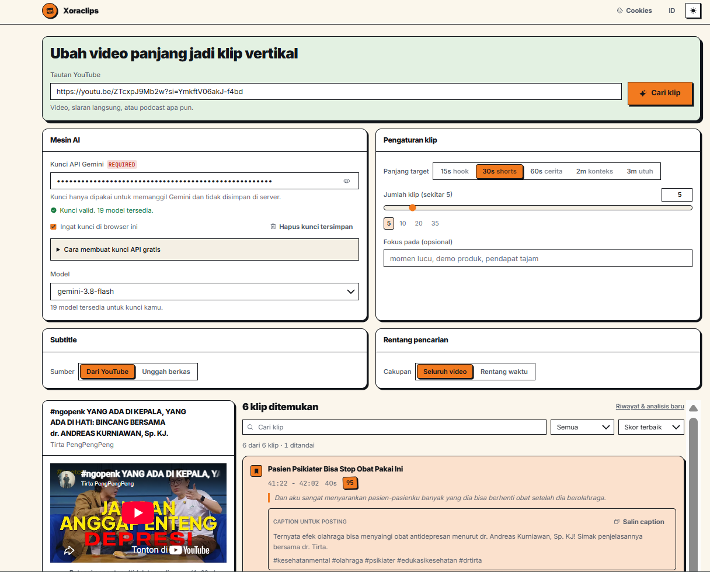
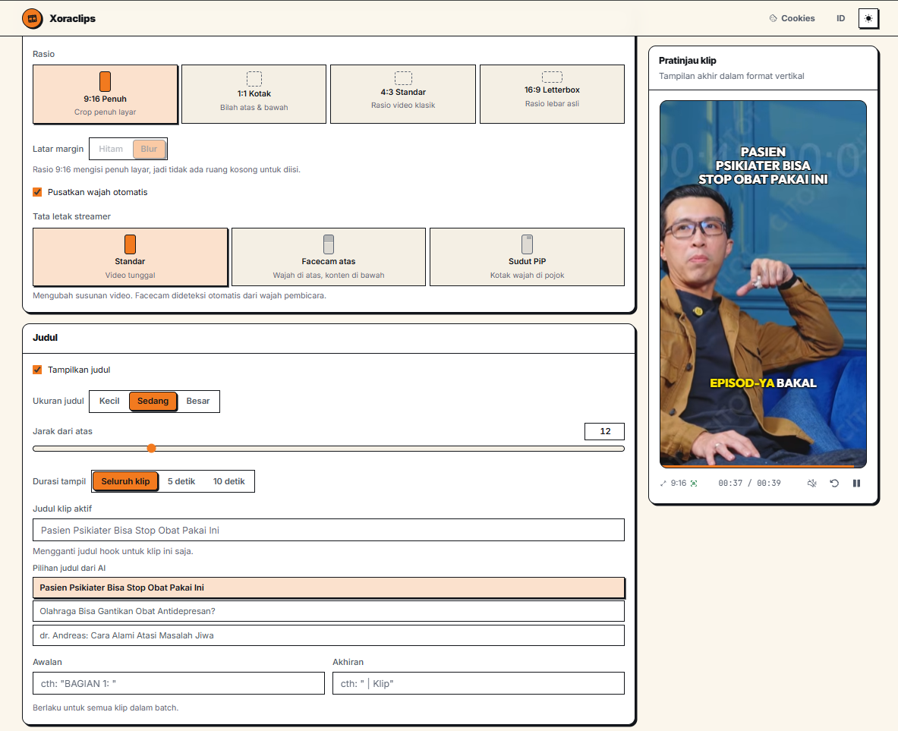

# Xoraclips

[English](README.md) | [Bahasa Indonesia](README.id.md)

[](https://github.com/M1xora/xoraclips/releases)


> **Beta.** The core flow works and has rendered real videos, but installation
> has only been tested on my own machine. If something breaks,
> [open an issue](https://github.com/M1xora/xoraclips/issues) — that helps most
> right now.

Turn long YouTube videos into vertical 1080x1920 clips ready for TikTok, Shorts, and Reels. Paste a link, Gemini picks the interesting parts, then you adjust each clip in the Studio and render it to MP4.

Built for solo creators and small channels who cut clips by hand and want the first pass done for them. The app runs locally on your own machine.

**1,296 tests** · **78 clips rendered** for real · **install cut 74%** (1029 → 268 MB) · **60 pull requests** reviewed and merged

## Demo

No hosted demo — the app runs locally and needs `ffmpeg` and `yt-dlp` installed.

Paste a link, pick a target length, get scored clips with ready-to-post captions:



Then adjust the framing, title, and subtitles before rendering:



## Features

- **AI clip selection** — Gemini reads the transcript and returns clips with a score, a hook title (three options each), and a caption with hashtags ready to post. Target length: 15s, 30s, 60s, 2min, or 3min.
- **Clip Studio** — output ratio, blurred or black margins, split-facecam and PiP layouts, titles, watermark, file name prefix and suffix.
- **Face tracking** — the crop follows the speaker's face, with manual controls when it needs help.
- **Word-level subtitles** — 7 styles, 8 fonts, size and position, taken from YouTube captions (Whisper is an optional fallback).
- **Audio** — background music and an intro SFX with volume and offset, audible in the preview.
- **Render and export** — batch render with hardware encoders (NVENC, AMF, QSV) detected per machine, plus export to JSON, Markdown, SRT, and YouTube chapter timestamps.

## Tech stack

**Frontend** — React 19, TypeScript (strict), Vite 8, Tailwind CSS v4, Vitest, ESLint.

**Backend** — Python 3.10+, FastAPI, yt-dlp, ffmpeg, OpenCV, google-genai (Gemini), youtube-transcript-api. OpenAI Whisper is optional.

## Getting started

### Prerequisites

- Node.js 18 or newer
- Python 3.10 or newer
- `ffmpeg` and `yt-dlp` available on your PATH
- A free Gemini API key from [Google AI Studio](https://aistudio.google.com/) — you paste it into the app, not into a file

Install ffmpeg and yt-dlp:

```bash
# Windows
winget install Gyan.FFmpeg
winget install yt-dlp.yt-dlp

# macOS
brew install ffmpeg yt-dlp
```

### Steps

1. Clone the repository.

   ```bash
   git clone https://github.com/M1xora/xoraclips.git
   cd xoraclips
   ```

2. Install dependencies.

   ```bash
   npm install
   python -m pip install -r backend/requirements.txt
   ```

3. Start the backend (first terminal).

   ```bash
   python -m uvicorn backend.main:app --port 8000
   ```

4. Start the frontend (second terminal).

   ```bash
   npm run dev-next
   ```

5. Open `http://localhost:5174/preview.html`. It must be `localhost`, not `127.0.0.1` — the YouTube player rejects other origins.

On Windows, `setup_and_run.bat` does all of the above automatically, and `start-xoraclips.bat` / `stop-xoraclips.bat` run and stop both servers afterwards.

Full setup notes, troubleshooting, and the optional Whisper install are in [docs/USAGE.md](docs/USAGE.md).

## Environment variables

There is no server-side API key. Every user enters their own Gemini key in the web form; it is sent in the `X-Gemini-Api-Key` header, used only for that request, and never stored or logged.

Everything below is optional. Copy `backend/.env.template` to `backend/.env` and fill in what you need — the template holds no real values.

| Variable | What it does |
|---|---|
| `MOCK_MODE` | `true` returns sample analysis data without calling Gemini or YouTube. For tests and demos. |
| `ALLOWED_ORIGINS` | Comma-separated browser origins allowed to read API responses (CORS). The local dev ports are the default. |
| `SUPADATA_API_KEYS` | Supadata keys for fetching transcripts through residential IPs. Comma-separated for round-robin. |
| `WEBSHARE_USERNAME` / `WEBSHARE_PASSWORD` | Webshare rotating proxy credentials, used when YouTube IP-blocks transcript requests. |
| `WEBSHARE_LOCATIONS` / `WEBSHARE_RETRIES` | Proxy country list and retry count. |
| `WEBSHARE_PROXY` / `PROXY_URL` | A full proxy URL instead of the username/password pair. |
| `REQUESTS_CA_BUNDLE` | Path to a custom CA bundle, for SSL-inspecting corporate proxies. |
| `EMOJI_FONT_PATH` | Path to a color emoji font. Falls back to the bundled `seguiemj.ttf`. |

## Testing

```bash
npm test                              # frontend — 481 tests, 36 files (Vitest)
python -m pytest backend/tests -q     # backend — 815 tests (pytest)
npm run typecheck-next                # tsc --strict
npm run lint-next                     # ESLint
npm run build-next                    # production build
```

1,296 tests in total. CI runs all of them on every pull request.

## Project structure

```
backend/          FastAPI, ffmpeg, yt-dlp. Endpoints in routes_*.py, rendering in video_engine.py
backend/tests/    pytest suite, with real transcript and Gemini fixtures
src-next/         Frontend
  api/            HTTP client for the backend
  features/       One folder per feature: analyze, studio, render, trimmer, player, export, …
  components/     Shared UI components
  hooks/ lib/     Shared hooks and helpers
```

## My contribution

The project started from [cheat-clip-pro](https://github.com/galihjuansaputra/cheat-clip-pro) (see [Credits](#credits)): its project layout and parts of the backend video pipeline were the starting point. Everything below was designed and built for this project.

| Area | What was built |
|---|---|
| **AI clip selection** | The whole analysis path: transcript and heatmap fused into one prompt, Gemini's JSON validated and repaired, a fallback chain across Flash models for 503s and quota limits, and backup clips picked from heatmap peaks when Gemini returns none. |
| **Streaming progress** | `/api/analyze` is one SSE stream that reports each stage as it happens, so a 90-second analysis is never a blank screen. The API key is validated first, so a wrong key fails in under a second instead of spending transcript quota. |
| **Clip Studio** | Output ratios, blurred or black margins, split-facecam and PiP layouts, titles with three generated options, watermarks, and a preview that matches the render. |
| **Face tracking** | OpenCV detection driving the crop, with the detected face size setting the zoom, plus manual controls for corner facecams and dark gameplay footage. |
| **Subtitles** | Word-level timing in 7 styles and 8 fonts, built from YouTube captions with Whisper as an optional fallback — which keeps ~737 MB out of a default install. |
| **Batch rendering** | Background tasks with per-clip status, hardware encoder detection (NVENC, AMF, QSV), partial-failure handling so one bad clip does not sink the batch, and a ZIP built only when it is first downloaded. |
| **Test suite** | 815 backend tests and 481 frontend tests, with the pure logic — clip bounds, caption timing, title rules — isolated from React and ffmpeg so it can be tested directly. |

Worked as a single-maintainer repo on a full Issue → Plan → Code → Review → Test → Merge flow: 70 issues closed across 60 reviewed pull requests, with CI green on every merge.

## What I learned

- **Rendering video is mostly about edge cases.** The happy path was quick; the work went into clips cut mid-sentence, videos with no transcript, and YouTube asking for a login. Most of the 815 backend tests exist because of one of those.
- **Depending on an external API means planning for it being down.** Gemini returns 503 under load, so the backend retries and falls back through a chain of models instead of failing the whole analysis.
- **Tests are what let me refactor.** Pure logic — clip bounds, caption timing, title rules — lives in its own files with no React or ffmpeg around it, so it can be tested directly and changed without fear.
- **Measuring beats guessing.** Install size turned out to be the biggest barrier for new users, so I measured it and made Whisper optional: Whisper's ~737 MB of a ~1029 MB install is no longer pulled in by default.

## Limitations

- **Not packaged.** You need Node, Python, ffmpeg, and yt-dlp installed yourself. Installation has only been tested on the developer's own machine.
- **Subtitle timing can drift.** Measured drift goes both ways (-1.8s to +1.4s) against YouTube captions, so a single offset setting would not fix it. Still unsolved.
- **Face tracking needs help sometimes.** Corner facecams and dark gameplay footage fall back to the manual controls.
- **Beta quality.** Version 0.9.5. The core flow works and has rendered real videos, but it has not been run at scale.

## Roadmap

- Make the app easier to install for people who do not develop software.
- Fix subtitle drift, which needs more sample videos to diagnose.

## Credits

Built on top of **[cheat-clip-pro](https://github.com/galihjuansaputra/cheat-clip-pro)** by **[galihjuansaputra](https://github.com/galihjuansaputra)**, which its README distributes under the MIT License. The initial project structure and parts of the backend video pipeline come from that work; what was built on top of it is listed under [My contribution](#my-contribution).

Also built on: [yt-dlp](https://github.com/yt-dlp/yt-dlp), [FFmpeg](https://ffmpeg.org/), [youtube-transcript-api](https://github.com/jdepoix/youtube-transcript-api), [OpenCV](https://opencv.org/), and [Whisper](https://github.com/openai/whisper).

## Author

**M1xora** — [GitHub](https://github.com/M1xora)

The code has no open-source license yet; all rights reserved. Get in touch via [Issues](https://github.com/M1xora/xoraclips/issues) before using or redistributing it.
